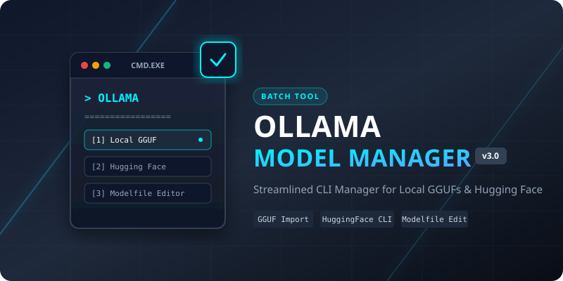

<div align="center">

  

  # Ollama Model Manager (v3)

  *A lightweight, menu-driven Windows Batch utility to import, customize, and manage Ollama LLM models.*

  [](https://www.microsoft.com/windows)
  [](https://ollama.com)
  [](LICENSE)

</div>

---

## 📖 Overview

**Ollama Model Manager V3** simplifies working with local GGUF files and Hugging Face repositories in [Ollama](https://ollama.com). Instead of manually crafting `Modelfile` syntax and running repetitive terminal commands, this interactive command-line tool guides you through creating, configuring, customizing system prompts, and launching models in seconds.

---

## ✨ Features

- 📁 **Import Local GGUF Files:** Scans your model folder for `.gguf` weights and configures them with a custom context window ($4\text{K}$, $8\text{K}$, or $16\text{K}+$).
- 🤗 **Direct Hugging Face Download:** Instantly pull GGUF models directly using standard `hf.co/` repository identifiers.
- 📝 **Interactive System Prompt Editor:** Opens Notepad dynamically to write multi-line system prompts without dealing with escape characters.
- ⚙️ **Edit Existing Models:** Easily update system prompts or parameters of models already installed in Ollama.
- 🗑️ **Uninstall & Manage:** View installed models and remove unwanted ones cleanly.
- 💬 **Run Session Launcher:** Launch interactive chat sessions with any model directly from the script interface.

---

## 🚀 Getting Started

### Prerequisites

1. **Windows OS** (Windows 10 / 11)
2. **Ollama Installed & Added to PATH**  
   Download and install Ollama from [ollama.com](https://ollama.com). Ensure the command `ollama` works in your Command Prompt.

### Installation & Directory Setup

1. Clone or download this repository.
2. By default, the script looks for models in `D:\AI MODEL`. 
   > **Note:** If you want to change the working directory, edit line 6 in `LLM MANAGER V3.bat`:
   > ```cmd
   > set "BASE_DIR=D:\AI MODEL"
   > ```
3. Place your `.gguf` model files into your designated base directory.

---

## 💻 Usage

Double-click `LLM MANAGER V3.bat` or run it from the command line:

```cmd
"LLM MANAGER V3.bat"
```

### Main Menu Options

```text
===================================================
              OLLAMA MODEL MANAGER
===================================================
 [1] Install a model from a local GGUF file
 [2] Download a model from Hugging Face
 [3] Edit system prompt / settings of an existing model
 [4] Uninstall a model
 [5] List installed models
 [6] Run a model
 [7] Exit
===================================================
```

---

## 🛠️ Detailed Workflow Examples

### 1. Registering a Local `.gguf` File
1. Drop your `.gguf` file inside `D:\AI MODEL\`.
2. Select **Option 1**.
3. Pick a Context Size:
   - **4K Context:** Recommended for $8\text{GB}$ RAM (Stable).
   - **8K Context:** Balanced performance.
   - **16K+ Context:** High memory requirement.
4. Set an optional custom system prompt (Notepad will launch automatically for input).

### 2. Pulling from Hugging Face
1. Select **Option 2**.
2. Enter the Hugging Face repo format, e.g.:
   ```text
   bartowski/Llama-3.2-3B-Instruct-GGUF:Q4_K_M
   ```
3. Ollama will automatically fetch and register the model.

### 3. Editing System Prompts
1. Select **Option 3**.
2. Select your installed model name.
3. Notepad will open showing the current `Modelfile`.
4. Modify parameters or the `SYSTEM """ ... """` block, then save and close Notepad to apply changes.

---

## 📜 License

Distributed under the MIT License. See `LICENSE` for more information.
